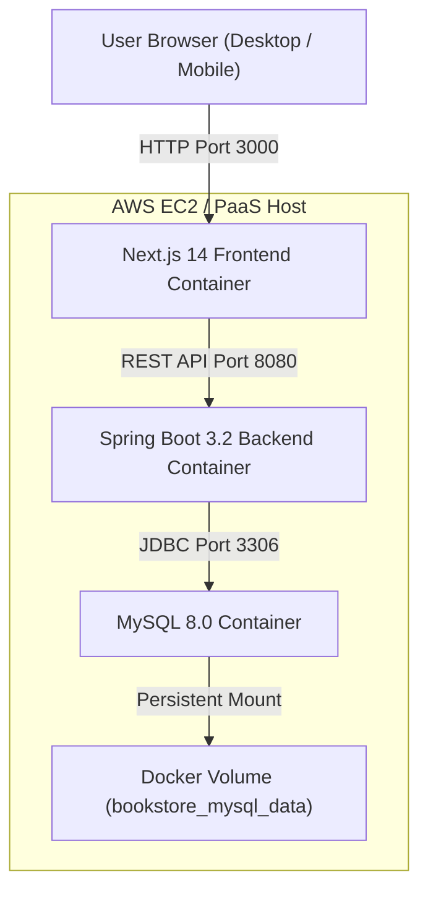

# 📚 PageCraft Bookstore — Full-Stack Cloud Application

An enterprise-ready, dynamic online bookstore web application featuring complete CRUD operations, real-time inventory synchronization, customer order placement, and fulfillment management.

Built with **Next.js**, **Java Spring Boot**, **MySQL**, and containerized using **Docker & Docker Compose** for streamlined zero-database-fee deployment on **AWS EC2** or **PaaS** platforms.

---

## 🌟 Key Features

1. **Display Book Details (Read)**:
   - Dynamic book grid with real-time stock indicators, pricing, cover imagery, and category badges.
   - Comprehensive **Book Specifications Modal** revealing ISBN, author profile, and detailed synopsis.
   - Live search (by Title, Author, ISBN, or Category) and one-click category filtering pills.

2. **Share New Books (Create)**:
   - "Share New Book" modal dialog with validation for Title, Author, ISBN, Price, Category, and Inventory.
   - Automatic uniqueness check for ISBN with descriptive HTTP 409 conflict handling.

3. **Update Book Information (Update)**:
   - In-place editing of book metadata, pricing, cover image URLs, and stock levels.
   - Immediate UI synchronization upon saving.

4. **Delete Books (Delete)**:
   - Safe deletion with confirmation dialog and responsive catalog update.

5. **Customer Order Management**:
   - Customer checkout modal: Name, Email, Contact Phone, and Delivery Address.
   - Automatic inventory deduction upon order placement.
   - Real-time order fulfillment dashboard: Change order statuses (`PENDING` ➔ `CONFIRMED` ➔ `SHIPPED` ➔ `DELIVERED`).
   - Order cancellation with automatic inventory stock replenishment.

---

## 🛠️ Architecture & Tech Stack



- **Frontend**: Next.js 14 (React 18), Standalone production build, Custom responsive dark theme, Glassmorphism, CSS tokens.
- **Backend**: Java 17, Spring Boot 3.2.3, Spring Data JPA, Hibernate, Jakarta Validation, Maven.
- **Database**: MySQL 8.0 with persistent named Docker volume (`bookstore_mysql_data`).
- **Containerization**: Multi-stage `Dockerfile` for frontend and backend, orchestrated via `docker-compose.yml`.
- **CI/CD**: GitHub Actions workflow (`.github/workflows/deploy.yml`) with automated SSH deployment.

---

## 📁 Repository Structure

```text
├── backend/
│   ├── src/main/java/com/bookstore/
│   │   ├── config/              # CORS configuration & DataInitializer
│   │   ├── controller/          # REST Controllers (Books, Orders, Health)
│   │   ├── dto/                 # Request payload DTOs
│   │   ├── model/               # JPA Entities (Book, CustomerOrder, OrderItem, OrderStatus)
│   │   ├── repository/          # Spring Data JPA Repositories
│   │   ├── service/             # Business Logic & Inventory transaction management
│   │   └── BookstoreApplication.java
│   ├── src/main/resources/      # application.properties (Environment-driven)
│   ├── pom.xml                  # Maven dependencies & build plugins
│   └── Dockerfile               # Multi-stage Alpine JRE container build
├── frontend/
│   ├── src/
│   │   ├── app/                 # Next.js App Router (page.js, layout.js, globals.css)
│   │   ├── components/          # React components (Navbar, BookCard, Modals, OrdersDashboard)
│   │   └── services/            # Client API abstraction
│   ├── next.config.js           # Next.js standalone output config
│   ├── package.json             # NPM dependencies
│   └── Dockerfile               # Multi-stage Alpine Node container build
├── .github/
│   └── workflows/
│       └── deploy.yml           # Automated GitHub Actions CI/CD to AWS EC2
├── docker-compose.yml           # Complete multi-container orchestration
├── .env.example                 # Environment configuration template
├── DEPLOYMENT_GUIDE.md          # Comprehensive AWS EC2 & PaaS deployment guide
└── README.md
```

---

## 🚀 Quick Start (Local Run with Docker)

To run the entire full-stack app (Frontend, Backend, and MySQL) in one command:

```bash
# 1. Copy sample environment file
cp .env.example .env

# 2. Build and start containers
docker compose up -d --build

# 3. View running services
docker compose ps
```

- **Frontend**: Open [http://localhost:3000](http://localhost:3000)
- **Backend API**: Open [http://localhost:8080/api/books](http://localhost:8080/api/books)
- **Healthcheck**: Open [http://localhost:8080/api/health](http://localhost:8080/api/health)

---

## 📡 REST API Reference

| Method | Endpoint | Description |
| :--- | :--- | :--- |
| `GET` | `/api/books` | Get all books (supports `?search=` and `?category=`) |
| `GET` | `/api/books/{id}` | Get book by ID |
| `POST` | `/api/books` | Create/share a new book |
| `PUT` | `/api/books/{id}` | Update existing book information |
| `DELETE` | `/api/books/{id}` | Delete book from catalog |
| `GET` | `/api/orders` | Retrieve all customer orders |
| `GET` | `/api/orders/{id}` | Retrieve order details by ID |
| `POST` | `/api/orders` | Place a customer order & update book inventory |
| `PATCH` | `/api/orders/{id}/status`| Update order status (`PENDING`, `CONFIRMED`, `SHIPPED`, etc.) |
| `DELETE` | `/api/orders/{id}` | Cancel/delete an order (restores stock if not fulfilled) |
| `GET` | `/api/health` | Health check probe |

---

## ☁️ Deployment Instructions

See [DEPLOYMENT_GUIDE.md](file:///c:/Users/yaswanth/Downloads/cloud%20lab/DEPLOYMENT_GUIDE.md) for full instructions on setting up AWS EC2, configuring Security Groups, adding GitHub Secrets, and deploying via GitHub Actions.
